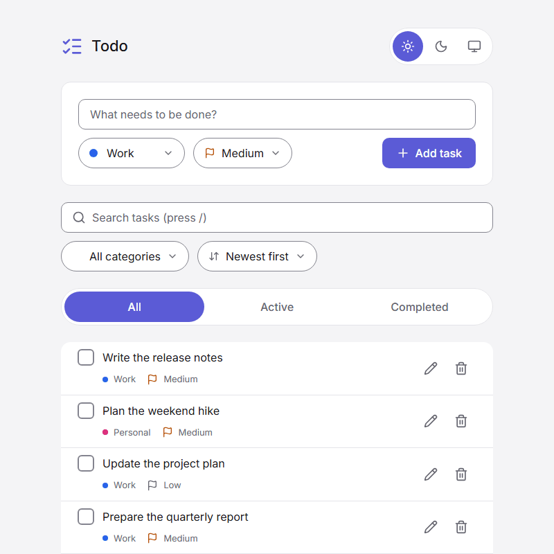

# Todo

✅ A fast, accessible todo list with categories, priorities, search, and filters, saved in your browser.

**[▶ Open the demo](https://todo-plum-nu-78.vercel.app/)**



Todo is a one-page app built with React 19 and Vite in plain JavaScript. Tasks never leave the browser: they are kept in localStorage or IndexedDB behind a swappable repository, and there is no backend, account, or analytics. The code is layered: constants, pure utilities, a storage layer, contexts for the app state, hooks for each component's logic, and components styled with plain CSS and design tokens.

## ✨ Features

- Add, edit, complete, and delete tasks, with Undo for a deletion
- A category (Work, Personal, Study, Shopping, Health) and a priority (Low, Medium, High) on every task
- Search with highlighted matches, focused with the `/` key
- Filters by status and category, and sorting by newest, oldest, or priority, kept in the URL
- A tasks-left counter, mark all as done or active, and Clear completed
- Light, dark, or system theme, with a circle-reveal transition
- Tasks saved in localStorage or IndexedDB and kept in sync across browser tabs
- Export and import of a JSON backup
- Keyboard and screen reader support, built for WCAG 2.2 AA
- Responsive from 320px wide, with reduced-motion support

## 🧰 Tech Stack

- React (React Compiler)
- Vite
- CSS (with design tokens)
- lucide-react
- idb
- localStorage and IndexedDB
- ESLint with jsx-a11y
- Prettier
- Husky and lint-staged
- size-limit
- GitHub Actions
- Vercel
- pnpm

## 📁 Project Structure

```text
src/
  components/
    app/                The root component: the providers, the header, the page and the toast region
    app-header/         The logo, the title and the theme switch
    category-dot/       The dot in a category's colour
    error-boundary/     The class that shows the error screen after a render error
    error-screen/       The error screen: the heading, Export backup and Reload
    filter-announcer/   The live region that says what the filters show
    filters-toolbar/    The search field, the Category and Sort pills and Reset
    icon-button/        An icon-only button
    pill-select/        A native select drawn as a pill
    search-field/       The labelled search input and its clear button
    status-switch/      The All, Active and Completed radio buttons
    text-button/        The text button of the footer, the toast and the backup row
    theme-switch/       The light, dark and system radio buttons
    toast/              The toast: its message and its action
    toast-region/       The live region that holds the toast
    todo-backup/        Export and import of a JSON backup
    todo-edit-form/     The edit form of a task row
    todo-footer/        The tasks-left counter, mark all and Clear completed
    todo-form/          The add-task form
    todo-item/          One task row
    todo-list/          The task list and its loading and empty texts
  constants/            Shared values: storage keys, categories, priorities, filters, limits
  context/
    todos/              TodosProvider and useTodos: the tasks and their actions
    theme/              ThemeProvider and useTheme: the theme choice
    toast/              ToastProvider and useToast: the one toast
  hooks/                Each component's logic and browser-API hooks
  storage/
    todo.repository.js            The TodoRepository contract and the helpers its implementations share
    local-storage.repository.js   The default implementation
    indexed-db.repository.js      The IndexedDB implementation
    create-repository.js          Picks the implementation by VITE_STORAGE
    theme.repository.js           The saved theme
  styles/               Design tokens, colour mapping, base styles and animations
  utils/                Pure functions: filtering, sorting, validation, highlighting, backup
  main.jsx              The entry point
public/                 Files served as they are: the font, the theme script, the favicon, the link preview image, robots.txt, llms.txt
assets/                 The demo GIF of this README
ai/                     Docs for AI agents: the repo map, rules, skills, decisions and plans
```

## ⚙️ Environment Variables

`VITE_STORAGE` picks where the tasks are kept: `localstorage` (the default) or `indexeddb`. The two
keep separate data. `.env.sample` shows the variable; copy it to `.env` and set a value.

## 🚀 Scripts

Install dependencies:

```bash
pnpm install
```

Run the local development server:

```bash
pnpm dev
```

Build the production version:

```bash
pnpm build
```

Preview the production build locally:

```bash
pnpm preview
```

Check the size budgets of the build (run `pnpm build` first):

```bash
pnpm size
```

Lint the code. ESLint also enforces the repo's conventions: kebab-case file names, named exports, and storage access only in `src/storage/`.

```bash
pnpm lint
```

Format the code:

```bash
pnpm format
```

Check the formatting:

```bash
pnpm format:check
```

## 🔄 CI

Every push runs [GitHub Actions](.github/workflows/ci.yml): lint, format check, build, and the size budgets from [`.size-limit.json`](.size-limit.json).

The pre-commit hook (Husky and lint-staged) runs ESLint and Prettier on the staged files.

`main` deploys to Vercel production through its Git integration; other branches get previews.
